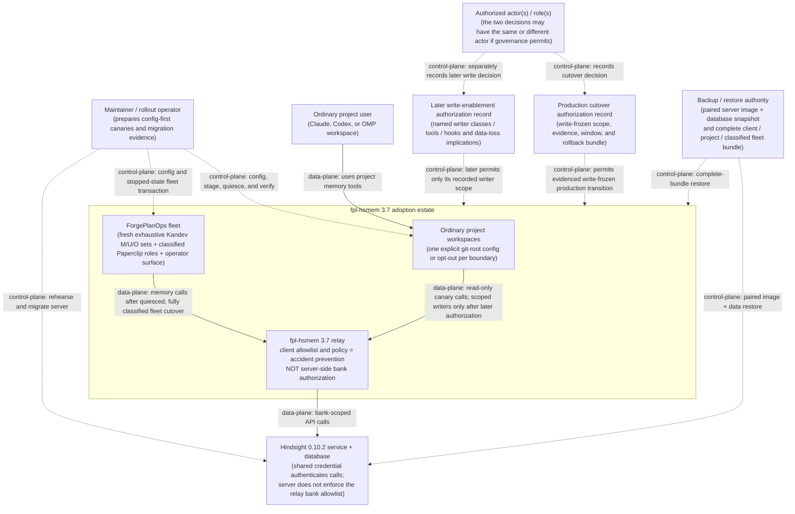

# C4 — ADR-030: Staged fpl-hsmem 3.7 adoption

> Co-located C4 projection extracted from ADR-030.
> ADR-030 is the source of truth; this file is the standalone boundary view
> required by its C4/review gate. It documents the intended rollout and does
> not authorize a merge, deployment, migration, write, or production go-live.

The decision spans ordinary project clients, the fpl-hsmem relay, the
Hindsight service and data store, the ForgePlanOps fleet, and the authorities
that control rollout and recovery. The two diagrams separate client-side
accident prevention from server-side authorization and separate data-plane
memory calls from control-plane rollout actions.

## C4 L1 — System Context

Who uses, operates, authorizes, and restores the staged memory system.

The solid arrows are data-plane use. The dashed arrows are control-plane
changes or authorizations. The relay can prevent a configured client from
accidentally selecting or calling an unapproved bank, but it cannot stop
another holder of the shared Hindsight credential from bypassing that client.
Server-side bank-scoped authorization remains an unresolved ADR-027 concern.
Production cutover authorization and later write enablement are distinct,
auditable records; the same or different authorized actor/role may make them
when governance permits. Read-only cutover never implies permission to enable
writes, hooks, autoRecall, autoRetain, or enrichment apply.

## C4 L2 — Container

The deployable/configuration boundaries and their rollout, data, and rollback
flows. Each dashed arrow is control-plane; each solid arrow is data-plane.

```mermaid
graph LR
    subgraph clients["Ordinary project client boundary"]
        claude["Claude plugin clients<br/>(one 3.7 plugin registration and one hook set)"]
        direct["Direct Codex / OMP clients<br/>(one direct 3.7 MCP path; no legacy bank env selector)"]
        autoRetain["Auto-retain hook writer<br/>own config + autoRetain + allowlist / existence checks<br/>direct HindsightClient; does NOT traverse BankGate"]
        legacyWriters["Legacy / direct writer paths<br/>(old registrations, hooks, sessions, and direct API clients)"]
    end

    gitConfig["Git-root .hindsight.json boundary<br/>(one valid new-schema config or explicit opt-out<br/>per ordinary project or ForgePlanOps root)"]

    subgraph relay["fpl-hsmem 3.7 relay boundary"]
        configGate["Config + version gate<br/>missing / disabled / invalid are distinct;<br/>active server range starts at 0.10.2"]
        toolPolicy["MCP discovery + call-time tool policy<br/>deny overrides allow; unknown tools invalidate config"]
        bankGate["BankGate<br/>allowed/default bank + existence preflight<br/>MCP CLIENT ACCIDENT PREVENTION ONLY"]
        tokenBoundary["Token boundary<br/>lazy, contained, local, non-committed;<br/>inactive config loads no token and makes no network call"]
    end

    subgraph hindsight["Hindsight 0.10.2 server boundary"]
        api["Hindsight 0.10.2 API<br/>shared-token authentication;<br/>no server enforcement of client policy or bank allowlist"]
        database[("Hindsight database<br/>banks, documents, memories, and links")]
    end

    subgraph fleet["ForgePlanOps fleet boundary"]
        kandevDb[("Kandev SQLite profiles<br/>inventory-time 21 rows: M=12 migrate Hindsight,<br/>U=9 unchanged empty, O=0 configured non-Hindsight<br/>fresh exhaustive M/U/O sets at cutover")]
        launcher["Fixed 3.7 launcher<br/>changes cwd to the ForgePlanOps git root"]
        paperclip["Eight Paperclip role sets<br/>Lander · Diagnost · Architect · Auditor<br/>Watchman · Forge · Summarizer · Reflection-Coach<br/>classified, effective cwd proved, instructions synchronized"]
        operators["Operator clients<br/>(exactly one Claude registration and one Codex registration)"]
        enrichment["Operator enrichment apply writer<br/>(explicit CLI + enrichment guards; separately gated)"]
    end

    subgraph controls["Rollout, authorization, and operational freeze control plane"]
        rollout["Rollout / rollback controller<br/>(serial gates: candidate → server → client → project → fleet)"]
        projectWave["Ordinary project waves<br/>config first; one git boundary at a time"]
        fleetTxn["Quiesced fleet transaction<br/>workers, heartbeats, schedules, and watchers stopped"]
        inventoryGate["Fresh fleet classification + concurrency gate<br/>live rows = M ∪ U ∪ O; every role classified;<br/>abort on unclassified entity or changed ID / preimage / set"]
        authActors["Authorized actor(s) / role(s)<br/>(same or different person may record each transition)"]
        cutoverAuth["Production cutover authorization record<br/>exact write-frozen scope, evidence, window, rollback"]
        writeAuth["Later write-enablement authorization record<br/>exact writer classes / tools / hooks and data-loss implications"]
        mcpFreeze["MCP writer freeze control<br/>all write tools absent at discovery and denied at call time"]
        retainFreeze["Auto-retain freeze control<br/>autoRetain=false; retain hook absent / disabled"]
        applyFreeze["Enrichment freeze control<br/>apply absent / not invoked; dry-run planning only"]
        legacyFreeze["Legacy/direct freeze control<br/>sessions, heartbeats, starts, schedules, watchers quiesced"]
    end

    subgraph rollback["Full-bundle rollback boundary — restore consistent parts together"]
        backup["Durable backup storage<br/>(verified restored rehearsal copy)"]
        serverPair["Server rollback pair<br/>0.9.1 image + pre-upgrade database snapshot"]
        clientBundle["Legacy runtime bundle<br/>config + binary + plugin + hooks + registrations<br/>+ complete classified Kandev / Paperclip / operator / service state"]
    end

    claude -.->|"control-plane: discover config at git root"| gitConfig
    direct -.->|"control-plane: discover config at git root"| gitConfig
    gitConfig -.->|"control-plane: parsed before runtime activation"| configGate
    claude -->|"data-plane: plugin MCP calls"| configGate
    direct -->|"data-plane: direct MCP calls"| configGate
    configGate -.->|"control-plane: lazy credential acquisition only when active"| tokenBoundary
    configGate -->|"data-plane: supported active MCP request"| toolPolicy
    configGate -.->|"control-plane: cached /version check before bank requests"| api
    toolPolicy -->|"data-plane: allowed read-only MCP call during canary"| bankGate
    bankGate -->|"data-plane: allowlisted bank + existence-checked MCP call"| api
    tokenBoundary -->|"data-plane: shared credential; not bank-scoped authority"| api

    claude -->|"data-plane: hook invocation when configured"| autoRetain
    gitConfig -.->|"control-plane: hook loads and checks its own config"| autoRetain
    autoRetain -->|"data-plane: direct HindsightClient writer path"| api
    operators -->|"data-plane: explicit operator command"| enrichment
    enrichment -->|"data-plane: separately guarded direct client / API path"| api
    legacyWriters -->|"data-plane: may bypass 3.7 client controls"| api
    api -->|"data-plane: accepted read / separately enabled write"| database

    kandevDb -.->|"control-plane: M rows select fixed launcher; U/O preimages preserved"| launcher
    launcher -.->|"control-plane: cwd anchors config discovery"| gitConfig
    launcher -->|"data-plane: Kandev memory client"| configGate
    paperclip -.->|"control-plane: effective cwd anchors config discovery"| gitConfig
    paperclip -->|"data-plane: classified role memory clients"| configGate
    operators -->|"data-plane: operator Claude / Codex MCP clients"| configGate
    operators -.->|"control-plane: operator config discovery"| gitConfig

    rollout -.->|"control-plane: advances only after prior evidence gate"| projectWave
    rollout -.->|"control-plane: enters only after project canaries"| fleetTxn
    projectWave -.->|"control-plane: config-first client cutover"| gitConfig
    projectWave -.->|"control-plane: atomically replace registrations"| clients
    fleetTxn -.->|"control-plane: recapture baseline after quiescence"| inventoryGate
    inventoryGate -.->|"control-plane: transactional M updates; preserve U/O"| kandevDb
    inventoryGate -.->|"control-plane: classify every role before resume"| paperclip
    fleetTxn -.->|"control-plane: single-registration cutover"| operators

    mcpFreeze -.->|"control-plane: enforced on MCP tool policy"| toolPolicy
    retainFreeze -.->|"control-plane: independently enforced on hook route"| autoRetain
    applyFreeze -.->|"control-plane: independently enforced on operator apply"| enrichment
    legacyFreeze -.->|"control-plane: independently enforced on old/direct routes"| legacyWriters
    legacyFreeze -.->|"control-plane: keeps fleet activity stopped"| fleetTxn
    authActors -.->|"control-plane: records first transition"| cutoverAuth
    authActors -.->|"control-plane: separately records later transition"| writeAuth
    cutoverAuth -.->|"control-plane: permits only the evidenced write-frozen rollout"| rollout
    writeAuth -.->|"control-plane: may later widen only named MCP scope"| mcpFreeze
    writeAuth -.->|"control-plane: may later widen only named hook scope"| retainFreeze
    writeAuth -.->|"control-plane: may later widen only named apply scope"| applyFreeze
    writeAuth -.->|"control-plane: may later widen only named legacy/direct scope"| legacyFreeze

    rollout -.->|"control-plane: create and verify rollback set"| backup
    backup -.->|"control-plane: retains paired server recovery"| serverPair
    backup -.->|"control-plane: retains complete legacy runtime recovery"| clientBundle
    serverPair -.->|"control-plane rollback: image and snapshot together"| api
    serverPair -.->|"control-plane rollback: restore matching data"| database
    clientBundle -.->|"control-plane rollback: ordinary clients as one bundle"| clients
    clientBundle -.->|"control-plane rollback: all classified fleet state"| fleet
```

## Module boundaries (narrative)

- **Ordinary project clients and git-root configuration**: Claude consumes one
  3.7 plugin registration and one hook set; Codex/OMP consumes one direct 3.7
  MCP path. Both discover the same new-schema `.hindsight.json` at the current
  git root. A nested repository or worktree is therefore a separate boundary
  unless explicitly classified as sharing an outer bank or opting out. Config
  exists before executable or registration cutover; legacy environment bank
  selection and duplicate registrations are removed atomically.
- **fpl-hsmem MCP path**: the config/version gate distinguishes missing,
  disabled, and invalid configuration, remains network- and token-free when
  inactive, and rejects unsupported server versions before any bank request.
  MCP discovery and call-time policy exclude or deny write tools during the
  freeze; allowed MCP calls then traverse BankGate's configured
  allowed/default-bank and existence checks. These controls constrain MCP
  clients only; they do not grant or enforce server-side bank authorization.
- **Other writer paths and operational freeze**: auto-retain independently
  loads project configuration, checks `autoRetain`, allowlisting, and bank
  existence, and uses `HindsightClient` directly rather than BankGate.
  Operator enrichment apply is a separately invoked and guarded path.
  Consequently the freeze is a conjunction of per-writer controls:
  `autoRetain=false` and retain hooks absent/disabled; MCP write tools absent
  and denied; enrichment apply absent/not invoked; and legacy/direct writers,
  sessions, heartbeats, starts, schedules, and watchers quiesced. It is not a
  central runtime component. Other shared-key holders remain an ADR-027 risk.
- **Token and server boundary**: tokens load lazily from contained,
  non-committed sources only for active valid configurations. Hindsight 0.10.2
  authenticates API calls with the shared credential, then reads or writes the
  database. Because that credential is not bank-scoped, another credential
  holder can bypass every client control. This is the security boundary that
  ADR-027 leaves open rather than a guarantee supplied by ADR-030.
- **ForgePlanOps fleet**: the current named design-time inventory has 21
  Kandev rows: `M=12` Hindsight entries to migrate, `U=9` deliberately
  unchanged empty rows, and `O=0` configured non-Hindsight rows. Cutover
  recaptures the live set after quiescence and requires a disjoint, exhaustive
  `M ∪ U ∪ O`, preserving every `U`/`O` preimage. All eight current Paperclip
  role sets—Lander, Diagnost, Architect, Auditor, Watchman, Forge, Summarizer,
  and Reflection-Coach—are named, classified, cwd-verified, and synchronized.
  Any unclassified entity or concurrent ID/preimage/set change aborts the
  transaction. Operator Claude and Codex each retain one 3.7 registration.
- **Rollout, authorization, and recovery**: one controller advances the serial
  candidate, server, independent-client, project-wave, and fleet gates.
  Production cutover and later write enablement require distinct auditable
  records; governance may assign the same or different authorized actor/role,
  but neither decision follows from implementation or read-only evidence.
  Durable backup storage retains the paired server image/database recovery
  point and complete legacy client/project/classified-fleet runtime bundle.
  The full-bundle boundary forbids restoring only a version, only data, only
  selected profile rows/roles, or only client wiring.

## Invariants and non-obvious constraints

1. The 3.7 config, BankGate, defaults-off hooks, lazy token handling, tool
   policy, guarded enrichment, generated bundles, and direct/plugin denials
   ship as one client safety model. Stages split exposure, not implementation.
2. A 3.7 bank-scoped request never reaches a server outside the evidenced
   version range. Inactive projects perform neither network access nor token
   commands; invalid config exposes zero tools and reports one redacted reason.
3. Every git boundary has one valid config or explicit opt-out before client
   cutover. Old and new Hindsight wiring are never active together on one host.
4. Initial policy is operationally write-frozen: hooks off, autoRecall false,
   autoRetain false, MCP tools minimal/read-only, enrichment apply absent, and
   legacy/direct writers quiesced. Each writer class is evidenced separately;
   widening any class requires scoped evidence and later authorization.
5. BankGate protects the MCP route from accidental client selection. The
   auto-retain, operator enrichment, legacy/direct, and other shared-key routes
   do not share that runtime choke point. BankGate is not a server ACL, and
   the shared token does not prove bank authorization.
6. An enrichment digest proves plan/content freshness only. It never proves
   human authorization, ownership, or permission to write.
7. No migration creates alias, derived, or duplicate banks, and historical
   data is neither merged nor deleted as part of client adoption.
8. Every live Kandev row belongs to exactly one fresh named `M`, `U`, or `O`
   set, and every live Paperclip role is classified. Updates equal `|M|`;
   every `U`/`O` preimage is unchanged. An unclassified entity or concurrent
   row/role/ID/preimage/set change aborts cutover rather than weakening a gate.
9. ForgePlanOps remains stopped wherever incompatible server/client state is
   possible or any writer freeze is unproved. Profile, cwd, instruction,
   operator, and restart changes form one fleet transaction, not live edits.
10. Rollback is complete-bundle: server image plus database snapshot; client
    config plus binary/plugin/hooks/registrations; and, for the fleet, complete
    classified SQLite/profile/role/instruction/operator/service state.
11. Architecture authorship, independent review, production cutover
    authorization, and later write enablement are separate recorded acts.
    Cutover never implies writes; the two authorizations may have the same or
    different actor/role when governing policy permits.
12. No central runtime write-freeze or universal BankGate choke point is
    assumed. MCP, auto-retain, operator enrichment, legacy/direct clients, and
    every newly inventoried writer each require an explicit freeze control and
    evidence.

## Rollout and rollback boundaries

- **Stage 0 — candidate**: make and freeze only ADR-030's narrow corrections
  and generated bundle manifest from the reviewed PR #319 head. There is no
  runtime or data change at this boundary.
- **Stage 1 — server**: restore a durable backup into staging, rehearse
  0.9.1→0.10.2 including the entity-name index migration, reconcile bank,
  document, memory, and link counts, and retain the paired 0.9.1 image and
  pre-upgrade snapshot before production migration.
- **Stage 2 — independent clients**: canary Claude plugin and Codex/OMP direct
  paths independently with config first, minimal read-only MCP tools,
  `autoRetain=false`, retain hooks and enrichment apply absent/disabled, one
  registration per runtime, and the same canonical bank result.
- **Stage 3 — ordinary projects**: move one project/git boundary at a time.
  Each wave removes duplicate and legacy paths atomically, verifies every
  writer-specific freeze control, and keeps its complete inactive legacy
  bundle until its canary passes.
- **Stage 4 — ForgePlanOps fleet**: quiesce all automatic activity; back up
  Hindsight, Kandev SQLite/WAL/full rows, all Paperclip role state, operator
  state, launcher, and services; then recapture and name every live row and
  role. Require exhaustive row sets `M ∪ U ∪ O` and classified roles. In one
  transaction, re-read IDs/preimages, update exactly `|M|`, preserve every
  non-Hindsight entry and `U`/`O` preimage, and assert the live set has not
  changed. Abort on any unclassified entity or concurrent drift. Verify the
  fixed launcher/effective cwd and synchronize all classified role
  instructions before resuming platforms, then support services and watchers.
- **Rollback before writes**: stop every MCP, auto-retain, enrichment,
  legacy/direct, and newly discovered writer path; restore both server parts
  and the matching client/project bundle plus all classified `M`/`U`/`O`
  rows, Paperclip roles, operator, launcher, and service state. Partial or
  mixed-state rollback is forbidden. All per-writer freeze controls remain
  closed until a separate write-enablement record authorizes named scopes.
- **Rollback after accepted writes**: snapshot restoration can discard valid
  post-cutover data. Repair-forward is preferred; restoring the snapshot
  requires a separate explicit data-loss authorization by the responsible
  authority.

## Reference

- **ADR-030** — source of truth for the staged server–client–project–fleet
  decision, acceptance gates, invariants, and rollback constraints.
- **NOTE-034** — canonical PR #319 research packet and provenance for reviewed
  head `b82e58e`, Hindsight versions, client/project/fleet inventory, and prior
  observed checks.
- **ADR-027** — draft decision refined by ADR-030; retains the unresolved
  distinction between client bank selection and server-side authorization.
- **NOTE-033** — historical causal evidence for pinned legacy selection and
  split-bank behavior.
- **EVID-278** — independent review whose F1–F3 findings require dynamic
  fleet accounting, real per-writer paths, and two distinct authorization
  records without mandatory person separation.
